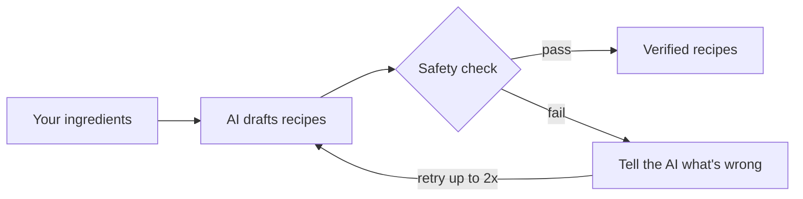
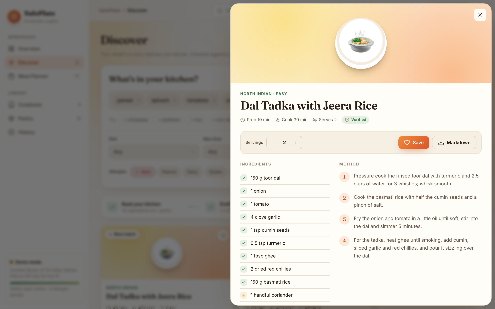
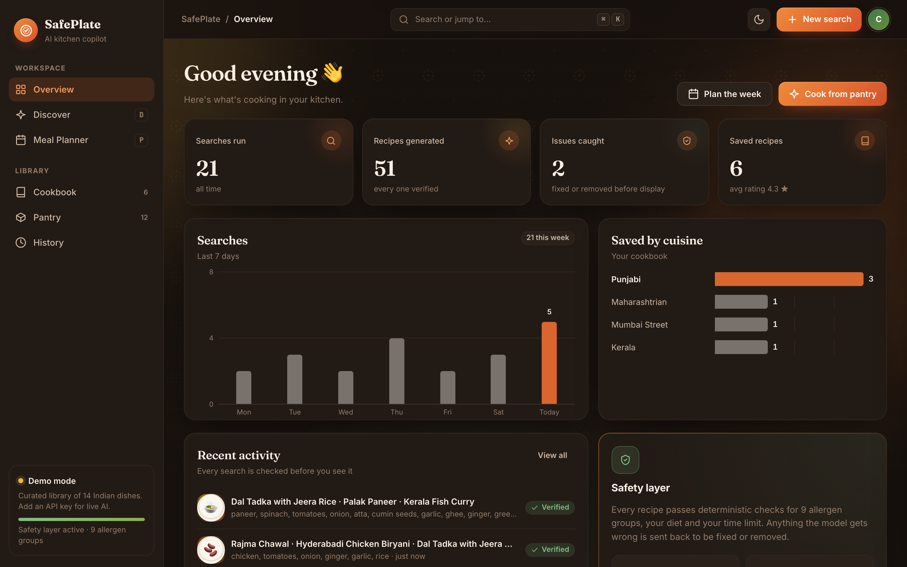

<div align="center">

# 🍽️ SafePlate

Indian recipes from what's in your fridge, checked against your allergies and diet
by an AI that fixes its own mistakes.


<br/>


</div>

## Features

- **Cook from your fridge**: Indian recipes ranked by how many of your ingredients they use
- **Allergy and diet safe**: 9 allergen groups, vegan/vegetarian/gluten-free and more, plus a time limit
- **Self-correcting AI**: if a recipe breaks a rule, the AI is told exactly why and fixes it
- **Meal planner**: 3–7 day plans across regions with one shopping list
- **Pantry, cookbook and history**: ratings shape future suggestions
- **Works offline**: 14 built-in Indian dishes when no API key is set

## How it works



In testing, this loop shows **about 5× fewer unsafe recipes** than trusting the AI directly,
while still delivering **98%+** of requested recipes. Scripts in `evaluation/` reproduce every number.

## Quick start

```bash
git clone https://github.com/MaddipatlaChetan24/SafePlate.git
cd SafePlate
pip install -r requirements.txt
python -m safeplate serve        # open http://127.0.0.1:8000
```

Add `OPENAI_API_KEY` to a `.env` file for live AI recipes (see `.env.example`).

## Screenshots

<table>
  <tr>
    <td width="50%"><br><sub><b>Discover</b></sub></td>
    <td width="50%"><br><sub><b>Recipe details</b></sub></td>
  </tr>
  <tr>
    <td><br><sub><b>Meal planner</b></sub></td>
    <td><br><sub><b>Dashboard (dark mode)</b></sub></td>
  </tr>
</table>

## Tech stack

Python · FastAPI · LangChain · OpenAI · Pydantic · SQLite · HTML/CSS/JavaScript · pytest · Docker

## Project structure

```
safeplate/     agent, safety checker, API, CLI, web app
evaluation/    benchmark and simulation scripts
tests/         40 tests
scripts/       screenshot tools
```

## Tests

```bash
python -m pytest -q
```

## License

MIT
