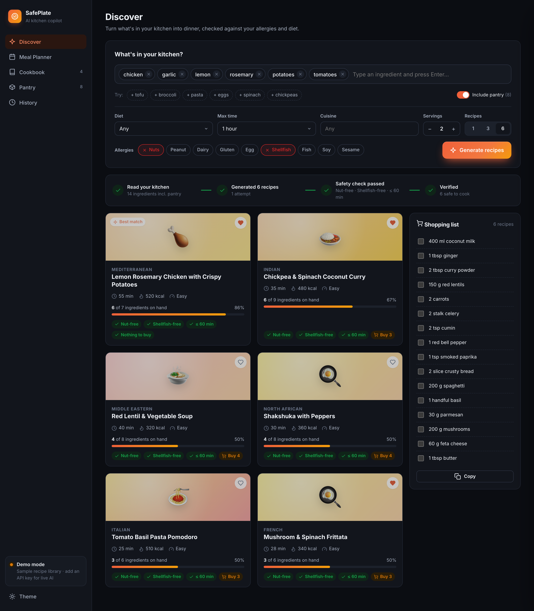
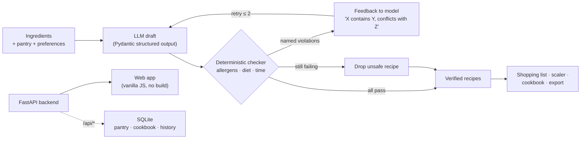
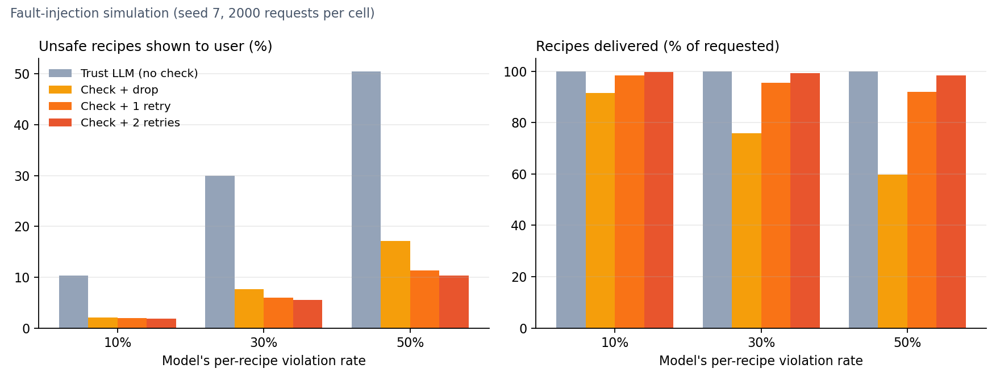

<div align="center">

# 🍽️ SafePlate

Tell it what's in your fridge — get recipes verified against your allergies and diet by a
deterministic checker, with an LLM that fixes its own mistakes before you ever see them.


**[Live demo →](https://YOUR-APP.onrender.com)**

<br/>

<picture>
  <source media="(prefers-color-scheme: dark)" srcset="docs/website_preview_dark.png">
  <source media="(prefers-color-scheme: light)" srcset="docs/website_preview_light.png">
  
</picture>

</div>

---

LLM recipe generators usually work one of two ways. Some (a) make a single call and
trust whatever comes back. That's cheap, but nothing stops the model from suggesting
pine-nut pesto to someone with a nut allergy. Others (b) ask the model to "double-check
itself", which uses another call to the same component that made the mistake. This
project puts a **deterministic verification layer** between the model and the user. A
rule-based checker inspects every ingredient. Violations go back to the model as
specific, named feedback for up to two repair rounds. Whatever still fails is removed.
The central questions: **how much unsafe output does that layer actually remove, what
does it cost, and where is its ceiling?**

Everything quantitative below comes from scripts in `evaluation/` and is reproducible
with a fixed seed. Where a number comes from a simulation rather than a real LLM, it is
labelled as such.

## Architecture



## Why this matters

**Food allergies are a safety problem, not a preference.** A wrong suggestion in a
recipe app is not like a mediocre movie recommendation. For a user with a severe allergy,
the cost of one bad output is far larger than the benefit of many good ones. That
asymmetry is why "the model is usually right" isn't good enough, and why this project
measures *unsafe recipes shown to the user* as its main metric rather than recipe
quality.

**Why rules rather than an LLM-as-judge.** An LLM checking an LLM shares its failure
modes and adds a second non-deterministic, billable call. A rule-based checker is
deterministic (same input, same verdict, every time), unit-testable, auditable line by
line, and costs **0.37 ms per recipe** (measured below) instead of a network round-trip.
Its weakness is just as clear. It can only flag what it can recognise, and this project
measures exactly how much that limits it (see "The ceiling" below).

**Why the loop instead of just filtering.** Dropping flagged recipes is safe but
wasteful. In the simulation below, check-and-drop alone delivers only **60% of
requested recipes** when the model errs at 50%. Sending the violations back recovers
delivery to **98%** without increasing unsafe output.

**Honest scope:** this is a portfolio project, not a medical device. Nothing here
replaces reading ingredient labels, and the limitations section lists specific allergens
the checker is known to miss.

## Setup

```bash
git clone https://github.com/YOUR-USERNAME/safeplate.git
cd safeplate
python -m venv .venv && source .venv/bin/activate
pip install -r requirements.txt
cp .env.example .env     # optional: add OPENAI_API_KEY; without it the app runs in demo mode
```

**Demo mode** (no API key) serves a curated library of 10 real recipes. They go through
the *same* checker, scaler and shopping-list code as LLM output, so the whole app can be
tried and tested for free. The sidebar shows which mode is active.

## Repository layout

```
safeplate/
  agent.py        generate → verify → self-correct loop, meal planner
  safety.py       deterministic allergen / diet / time checker
  models.py       Pydantic models: Recipe, Ingredient, Preferences, MealPlan
  samples.py      curated offline recipe library (demo mode)
  shopping.py     fuzzy ingredient matching + shopping-list merging
  storage.py      SQLite: pantry, cookbook, ratings, history
  export.py       Markdown export
  server.py       FastAPI backend
  cli.py          rich terminal interface
  web/            frontend: plain HTML/CSS/JS, no build step
evaluation/
  allergen_benchmark.py   held-out benchmark of the checker (3 matchers compared)
  self_correction_sim.py  fault-injection simulation of the full loop
  latency_cost.py         wall-clock + token-estimate measurements
results/                  CSVs and plots produced by evaluation/
tests/                    32 pytest tests (core logic + every API endpoint)
```

## Running

```bash
# Web app → http://127.0.0.1:8000  (API docs at /docs)
python -m safeplate serve

# CLI
python -m safeplate suggest -i "chicken, garlic, lemon" --allergies nuts --time 30
python -m safeplate plan --days 5 --use-pantry --export exports/
python -m safeplate cookbook list

# Reproduce every number in this README
python -m evaluation.allergen_benchmark
python -m evaluation.self_correction_sim
python -m evaluation.latency_cost
```

## Design choices and why they matter

**Structured output, not regex-parsed JSON.** The model's answer is validated against
Pydantic models via `with_structured_output`. The original prototype extracted JSON with
a regex, which breaks silently on a stray code fence. Typed output also gives the checker
clean per-ingredient names to inspect instead of free text.

**Feedback names the exact violation.** The retry message is not "try again". It lists
each problem, e.g. *"'Satay Bowl' contains 'peanut', which conflicts with allergy
'peanut'"*, followed by *"Replace or fix ONLY those recipes and return the full set
again."* The model fixes the specific recipe instead of regenerating the whole set and
possibly introducing new problems in recipes that were fine.

**Drop, don't warn.** After the retry budget runs out, a recipe that still fails is
removed, and the UI says how many issues were caught. A warning badge on an unsafe recipe
would still put the unsafe recipe in front of the user.

**Demo data uses the production code path.** The offline library isn't a mock. It is
matched, filtered, scaled and merged by the same functions as LLM output, so tests and
screenshots exercise real code.

**One SQLite connection per request.** The FastAPI layer opens a short-lived `Store` per
request rather than sharing one connection across the threadpool, which avoids
cross-thread SQLite errors without adding a lock.

## Sanity-checking the allergen checker (and two real bugs it caught)

The first version of the checker used plain substring matching, and it failed on cases
spotted while writing the unit tests. "Coconut milk" was flagged for a nut allergy
(contains "nut"), and "champignon" was flagged as non-vegetarian (contains "ham"). The
fix had two parts. Matching now happens only at word starts (`\bkeyword`). A rewrite
table maps known safe phrases first ("almond milk" → "almond", so it still counts as a
nut but no longer as dairy).

Those unit-test cases became the *dev set*. To get an honest number, a separate
**held-out set of 70 cases** (39 that should be flagged, 31 that should pass) was written
*after* the rules were frozen, covering compound words, plant-based substitutes,
misleading names (buckwheat, water chestnuts) and hidden allergens. Three matchers using
identical keyword lists were compared:

| matcher | accuracy | precision | recall | F1 | false alarms | missed |
|---|---|---|---|---|---|---|
| naive substring | 0.557 | 0.569 | **0.846** | 0.680 | 25 | 6 |
| word-boundary only | 0.657 | 0.660 | 0.795 | 0.721 | 16 | 8 |
| **word-boundary + rewrites (v1, frozen)** | **0.814** | **0.861** | 0.795 | **0.827** | **5** | 8 |

**The naive matcher has the best recall, and that is a real trade-off, not noise.**
Substring matching catches "catfish" and "cornbread" because "fish" and "bread" sit
inside them. Word-boundary matching misses both. The naive matcher pays for those 2 extra
catches with 25 false alarms, which would make the app refuse most plant-based cooking
(coconut, eggplant, butternut, nutmeg). The shipped matcher keeps recall roughly level
with the word-boundary version (0.795 for both) and cuts false alarms by 5× (25 → 5).

**Two of the shipped matcher's 13 errors were bugs, not coverage gaps,** and both were
fixed:

1. **"anchovies" was not flagged for a fish allergy.** The keyword is "anchovy", and
   "anchovies" doesn't contain it, so the "plurals still match" assumption only held for
   `-s` plurals. The fix: `-y` keywords also match `-ies`.
2. **"vegan cheese" was flagged as not vegan.** The rewrite table mapped it to "plant
   cheese", which still contains "cheese". The fix: rewrite to a neutral phrase.

After fixing those two bugs, the shipped matcher scores **0.843 accuracy, 0.889
precision, 0.821 recall (F1 0.853)**. That run is **not held-out** any more, because the
fixes were prompted by this set, so the frozen v1 row above is the honest generalisation
estimate. Both bugs now have regression tests in `tests/test_core.py`. The remaining 11
errors were **deliberately left unfixed** rather than patched one by one to inflate the
score. They are listed under "Limitations". Per-case results:
`results/allergen_benchmark_cases_v1_frozen.csv`.

## Does the loop actually reduce unsafe output? (fault-injection simulation)

Measuring this against a real LLM would make the result depend on one model's error rate
on one day, and it would cost money per run. Instead, `evaluation/self_correction_sim.py`
replaces the model with a scripted **faulty model**. It returns real library recipes, but
with probability *p* it slips a nut ingredient into each one. 80% of the injected
ingredients are *detectable* (named directly, e.g. "cashews"). 20% are *hidden* inside
compound ingredients ("pesto", "praline", "satay dressing") that the checker can't see
into. When told about a flagged recipe, the model fixes it 80% of the time. It never
fixes what it wasn't told about.

**This is a simulation with stated assumptions, not a measurement of any real model.**
Ground truth comes from what was injected, not from the checker's own opinion. 2,000
requests × 3 recipes per cell, seed 7, with every configuration run on the same random
stream (paired).

| model error rate | configuration | unsafe recipes shown | recipes delivered | LLM calls / request |
|---|---|---|---|---|
| 10% | trust the LLM (no check) | 10.38% | 100.0% | 1.00 |
| 10% | check + drop | 2.04% | 91.5% | 1.00 |
| 10% | **check + 2 retries** | **1.92%** | **99.7%** | 1.28 |
| 30% | trust the LLM (no check) | 30.00% | 100.0% | 1.00 |
| 30% | check + drop | 7.65% | 75.8% | 1.00 |
| 30% | **check + 2 retries** | **5.59%** | **99.2%** | 1.70 |
| 50% | trust the LLM (no check) | 50.53% | 100.0% | 1.00 |
| 50% | check + drop | 17.19% | 59.7% | 1.00 |
| 50% | **check + 2 retries** | **10.39%** | **98.3%** | 2.02 |

<p align="center"></p>

**Reading it:** the loop cuts unsafe output by **about 5×** (4.9–5.4×) at every error rate while
delivering **98–99.7%** of requested recipes. Check-and-drop alone is about as safe, but
at a 50% error rate it throws away 40% of results. The retries are what make the safety
layer usable.

**The ceiling.** The residual unsafe rate with 2 retries (1.92%, 5.59%, 10.39%) almost
exactly matches the **hidden-allergen rate** (20% of *p* = 2%, 6%, 10%). The loop removes
essentially every violation the checker can see, and none of the ones it can't. **The
system's safety is bounded by the checker's recall, not by the loop.** More retries
won't help. A better checker will. That makes the hidden-allergen gap in the benchmark
above the most important thing to fix next, not a footnote.

## Cost comparison across configurations

App-side timings were measured on an Apple M5 Pro, single process, in demo mode. They
cover the app's own overhead, not model latency, which depends on the provider. Token
counts are **estimates** from payload size (~4 characters per token), not billed numbers.

| configuration | LLM calls / request (at 30% error) | est. tokens / request | added app-side latency |
|---|---|---|---|
| trust the LLM | 1.00 | ~1,150 | none |
| check + drop | 1.00 | ~1,150 | ~1.1 ms (3 recipes × 0.37 ms) |
| **check + 2 retries** | **1.70** | **~2,640 (≈2.3×)** | ~1.1 ms per round |

A retry costs more than a first call (≈1,220 input tokens vs ≈240), because it re-sends
the previous answer plus the feedback. Across error rates, the estimated token
multiplier for 2 retries is about **1.5× at 10%, 2.3× at 30% and 2.9× at 50%**. You pay
for safety roughly in proportion to how often the model gets it wrong.

| operation (measured) | p50 | p95 |
|---|---|---|
| safety check, 1 recipe (9 allergens + vegan + time limit) | 0.369 ms | 0.391 ms |
| shopping list, 7 recipes merged | 0.081 ms | 0.085 ms |
| scale recipe to 6 servings | 0.006 ms | 0.007 ms |
| `POST /api/suggest` (demo, 3 recipes, end to end) | 2.12 ms | 2.32 ms |
| `POST /api/plan` (demo, 7 days) | 2.91 ms | 2.99 ms |

**The practically important point:** verification is sub-millisecond, while each LLM
call is a network round-trip. The only cost that matters is the extra *calls*, and those
only happen when the model actually made a mistake.

## Limitations

Found by the held-out benchmark and left as documented gaps rather than patched to fit
the test set:

- **Hidden allergens in compound ingredients:** "pesto" (pine nuts) and "Worcestershire
  sauce" (anchovy) pass. The checker sees ingredient *names*, not recipes-within-
  ingredients. Per the simulation, this is the factor that bounds overall safety.
- **Specific names missing from keyword lists:** "cheddar" and "ricotta" (dairy), and
  "gelatin" (vegetarian).
- **Compound words:** "catfish" and "cornbread" are missed, the cost of word-boundary
  matching.
- **Conservative false alarms:** "rice flour", "rice noodles" and "gluten-free pasta" are
  flagged for a gluten allergy, and "cocoa butter" for dairy. These are safe-direction
  errors, but they reduce variety.
- The self-correction results are from a **simulation with stated assumptions** (80% fix
  rate, no new violations on retry). Real models will differ.

## Future work

**Compound-ingredient expansion.** Decompose ingredients like "pesto" into their
components before checking, using a curated table first and possibly an LLM-proposed
decomposition that is itself verified. The simulation says this is the highest-leverage
improvement available.

**An allergen ontology instead of keyword lists.** Map ingredients to allergen classes
(e.g. FoodOn) rather than maintaining strings by hand, which would also cover the
cheese-name gaps.

**Measure against real models.** Run the held-out constraints through several real LLMs
to replace the simulation's assumed error and fix rates with measured ones.

**Multi-provider support** (Claude, Gemini, local models) and **photo-to-ingredients**
input.

## Frontend + backend app

`safeplate/web/` (plain HTML/CSS/JS, no framework, no build step) is served by
`safeplate/server.py` (FastAPI). Every view fetches live data from the API, and the
**agent trace** bar on the Discover page shows each step of the loop as it runs:
ingredients read, recipes generated, issues caught and self-corrected, verified.

<table>
  <tr>
    <td width="50%"><br><sub><b>Recipe drawer</b>: on-hand vs to-buy, method, macro chart, serving scaler</sub></td>
    <td width="50%"><br><sub><b>Meal planner</b>: weekly stats and a merged shopping list</sub></td>
  </tr>
  <tr>
    <td><br><sub><b>Cookbook</b>: ratings feed back into future suggestions</sub></td>
    <td><br><sub><b>Dark mode</b> and a responsive mobile layout</sub></td>
  </tr>
</table>

**Endpoints:** `POST /api/suggest`, `POST /api/plan`, `POST /api/scale`,
`POST /api/export/markdown`, `GET|POST|DELETE /api/pantry`,
`GET|POST|PATCH|DELETE /api/cookbook`, `GET /api/history`, `GET /api/status`.
Interactive docs are at `/docs`. Missing cookbook items return 404, not 500.

**Deploy:** a `Dockerfile` and `render.yaml` are included. On Render, choose
*New → Blueprint*, point it at this repo, and optionally set `OPENAI_API_KEY`. Without a
key it deploys in demo mode. The free tier's disk is ephemeral, so saved recipes reset
on redeploy.

## Testing

```bash
python -m pytest -q
```

32 tests: serving scaling, 14 allergen/diet edge cases (including the two regressions
above), the self-correction loop with scripted model responses (retry and give-up
paths), shopping-list merging, storage, and every API endpoint.

## Acknowledgements

Started from the single-file
[Recipe Recommendation Agent](https://github.com/ashishpatel26/500-AI-Agents-Projects/tree/main/agents/17-recipe-agent)
by ashishpatel26 (MIT). The verification loop, evaluation suite, persistence, meal
planner, API, web app and tests were built on top of it.
