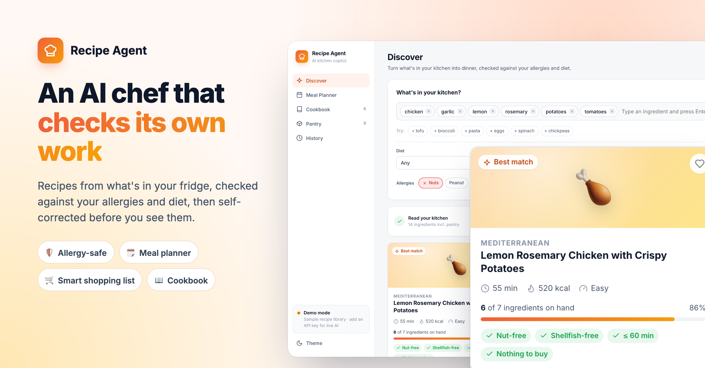
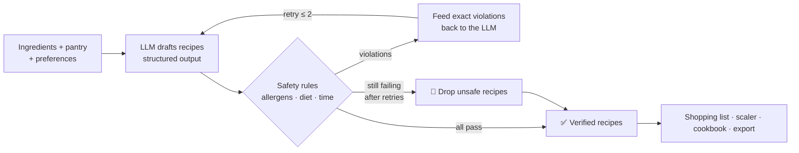
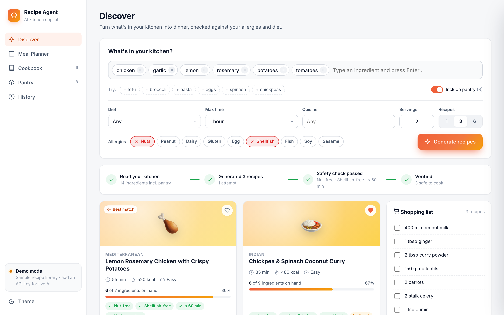
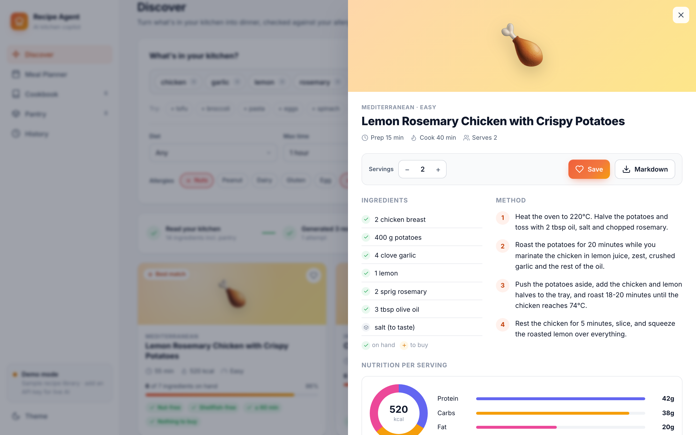
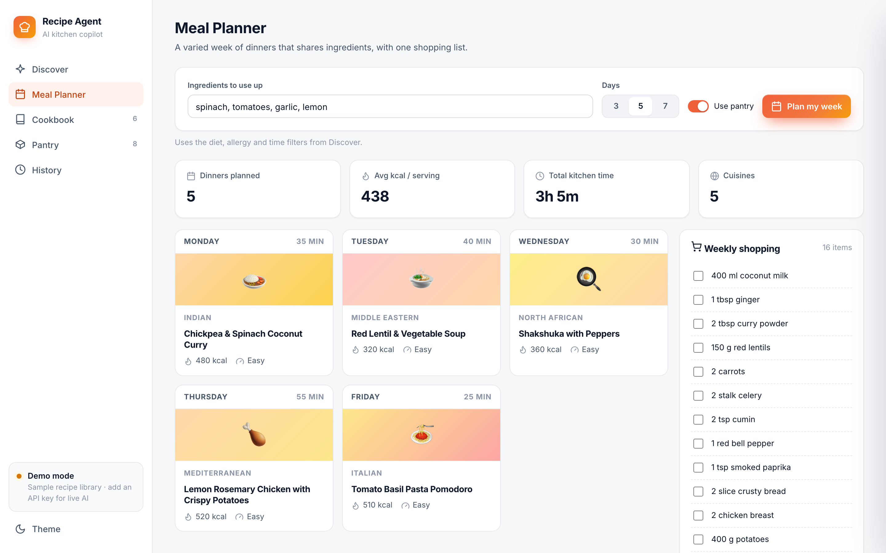
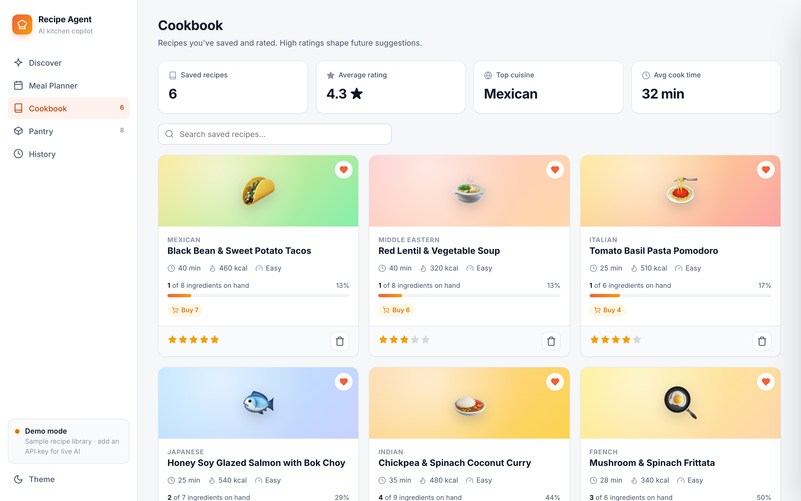
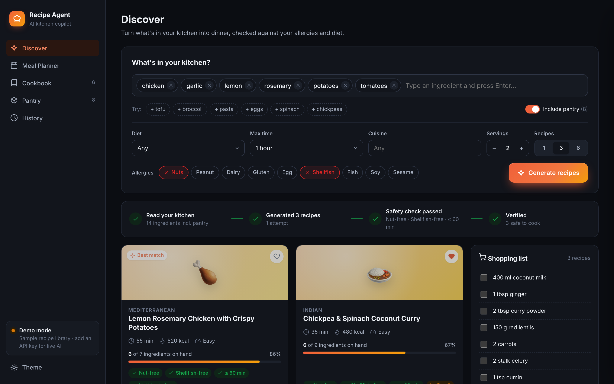
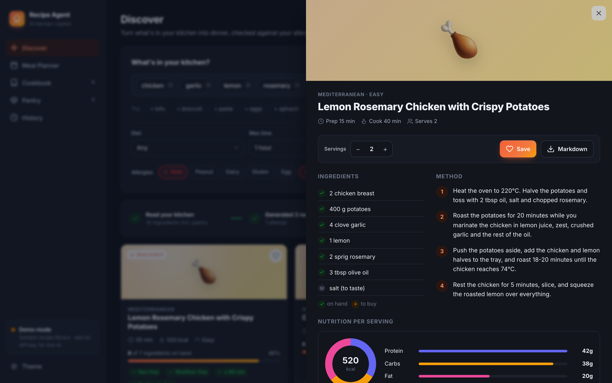
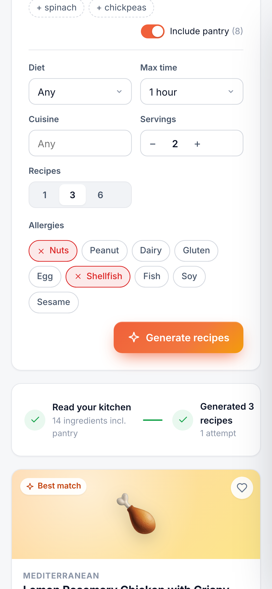
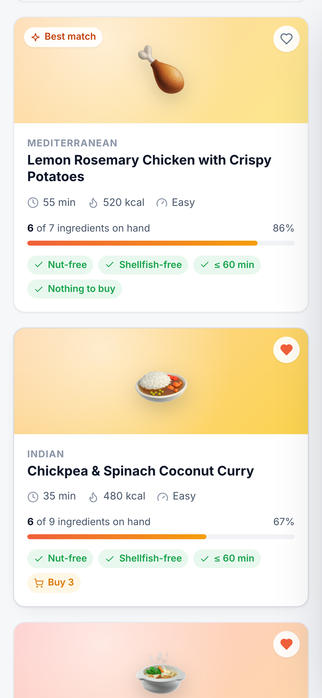

<div align="center">



# 🍳 Recipe Agent

**An AI kitchen copilot that turns what's in your fridge into recipes, checks every one against your allergies and diet, and fixes its own mistakes before you see them.**


[Features](#-features) · [How it works](#-how-the-agent-works) · [Quick start](#-quick-start) · [Screenshots](#-screenshots) · [API](#-rest-api)

</div>

---

## Why

Most "AI recipe generators" make one LLM call and trust whatever comes back. That's fine until the model suggests pesto with pine nuts to someone with a nut allergy.

Recipe Agent treats the LLM as a **drafting step, not the final answer**. Every recipe goes through deterministic safety rules. If something breaks a constraint, the agent sends the exact violations back to the model and asks it to fix them. Anything still unsafe after the retries is dropped, never shown.

## ✨ Features

|  |  |
|---|---|
| 🛡 **Self-correcting agent loop** | Generate → verify → feed violations back → regenerate (up to 2 retries). Unsafe recipes are removed, never shown. |
| 🥜 **Allergy & diet engine** | 9 allergen groups + vegan / vegetarian / pescatarian / gluten-free / dairy-free. Knows *coconut milk* isn't dairy, *eggplant* isn't egg, and *almond milk* **is** a nut. |
| 🧾 **Typed structured output** | Pydantic models with `with_structured_output`, so no regex JSON parsing. |
| 📊 **Ingredient match score** | Every card shows how many of your ingredients the recipe uses ("6 of 7 on hand"). |
| 🗓 **Meal planner** | 3/5/7-day dinner plans that vary cuisines and reuse perishables to cut food waste. |
| 🛒 **Smart shopping list** | Merges ingredients across recipes, adds up matching quantities, and skips pantry items and staples. |
| 🥫 **Pantry** | Save what you always have and include it in any search with one toggle. |
| 📖 **Cookbook + personalisation** | Save and rate recipes. Cuisines you rate 4★ or higher are favoured in future suggestions. |
| ⚖️ **Serving scaler** | Rescale any recipe from 1 to 20 servings. |
| 📝 **Markdown export** | Export single recipes or a full week plan. |
| 🌗 **Polished web app** | Responsive SaaS-style UI with dark mode, a live agent trace, and a recipe detail drawer with a macro chart. No build step. |
| 💻 **CLI too** | Every feature is also available from a rich terminal interface. |
| 🔌 **Offline demo mode** | Runs on a curated recipe library when there's no API key, so anyone can try it for free. |

## 🧠 How the agent works



The violations sent back to the model are specific, e.g. *"'Pesto Pasta' contains 'pine nuts', which conflicts with allergy 'nuts'"*. The model fixes those recipes instead of starting over. The web UI shows each step live in the **agent trace** bar.

## 📸 Screenshots

<table>
  <tr>
    <td width="50%"><br/><sub><b>Discover</b>: ingredient chips, filters, live agent trace, match scores</sub></td>
    <td width="50%"><br/><sub><b>Recipe drawer</b>: on-hand vs to-buy, steps, macro chart, serving scaler</sub></td>
  </tr>
  <tr>
    <td><br/><sub><b>Meal planner</b>: weekly stats and a merged shopping list</sub></td>
    <td><br/><sub><b>Cookbook</b>: ratings and stats that shape future suggestions</sub></td>
  </tr>
  <tr>
    <td><br/><sub><b>Dark mode</b></sub></td>
    <td><br/><sub><b>Dark mode</b>: recipe drawer</sub></td>
  </tr>
</table>

<p align="center">&nbsp;&nbsp;</p>

## 🚀 Quick start

```bash
git clone https://github.com/<your-username>/recipe-agent.git
cd recipe-agent
pip install -r requirements.txt
cp .env.example .env          # optional: add OPENAI_API_KEY for live AI
python -m recipe_agent serve  # → http://127.0.0.1:8000
```

With no API key, the app runs in **demo mode** on a built-in library of 10 real recipes. They go through the same safety checks, scaling and shopping-list logic.

### CLI

```bash
python -m recipe_agent suggest -i "chicken, garlic, lemon" --allergies nuts --time 30
python -m recipe_agent suggest --use-pantry --diet vegan --save --export exports/
python -m recipe_agent plan --days 5 --use-pantry --export exports/
python -m recipe_agent pantry add rice onion "soy sauce"
python -m recipe_agent cookbook list
python -m recipe_agent cookbook show 3 --servings 6
python -m recipe_agent cookbook rate 3 5 --notes "more chilli next time"
python -m recipe_agent shop 1 3 4
python -m recipe_agent history
```

`pip install -e .` installs it as a `recipe-agent` command.

### Configuration

| Variable | Default | Purpose |
|---|---|---|
| `OPENAI_API_KEY` | none | Enables live LLM generation. Without it, the app runs in demo mode. |
| `RECIPE_AGENT_MODEL` | `gpt-4o-mini` | Any OpenAI chat model |
| `RECIPE_AGENT_HOME` | `~/.recipe_agent` | Location of the SQLite database |

## 🔌 REST API

Interactive docs at `/docs` (Swagger) once the server is running.

| Method | Endpoint | Description |
|---|---|---|
| `POST` | `/api/suggest` | Generate verified recipes + shopping list + agent trace |
| `POST` | `/api/plan` | Multi-day meal plan with merged shopping list and Markdown |
| `POST` | `/api/scale` | Rescale a recipe to N servings |
| `POST` | `/api/export/markdown` | Recipe → Markdown |
| `GET/POST/DELETE` | `/api/pantry` | Manage pantry items |
| `GET/POST/PATCH/DELETE` | `/api/cookbook` | Saved recipes, ratings and stats |
| `GET` | `/api/history` | Recent searches |

## 🏗 Project structure

```
recipe_agent/
├── agent.py      # generate → verify → self-correct loop, meal planner
├── safety.py     # deterministic allergen / diet / time rules
├── models.py     # Pydantic models: Recipe, Ingredient, Preferences, MealPlan
├── samples.py    # curated offline recipe library (demo mode)
├── shopping.py   # ingredient matching + shopping-list merging
├── storage.py    # SQLite: pantry, cookbook, ratings, history
├── export.py     # Markdown export
├── server.py     # FastAPI backend
├── cli.py        # rich terminal UI
└── web/          # SPA frontend: vanilla JS + CSS, no build step
tests/            # 30 pytest tests (core logic + API)
```

**Stack:** Python · FastAPI · LangChain · OpenAI · Pydantic v2 · SQLite · Rich · vanilla JS/CSS · pytest · Playwright (screenshots)

## 🧪 Tests

```bash
python -m pytest -q
```

Covers serving scaling, 12 allergen/diet edge cases, the self-correction loop (scripted LLM responses), shopping-list merging, storage, and every API endpoint.

## 🗺 Roadmap

- [ ] Photo-to-ingredients (vision model reads your fridge)
- [ ] Multi-provider support (Claude, Gemini, local models)
- [ ] Nutrition targets per day/week
- [ ] Shareable recipe links

## 🙏 Acknowledgements

Started from the single-file [Recipe Recommendation Agent](https://github.com/ashishpatel26/500-AI-Agents-Projects/tree/main/agents/17-recipe-agent) by ashishpatel26 (MIT). I rebuilt and extended it with the self-correcting safety loop, typed output, persistence, meal planning, a REST API, the web app and the test suite.

## License

MIT. See [LICENSE](LICENSE).
