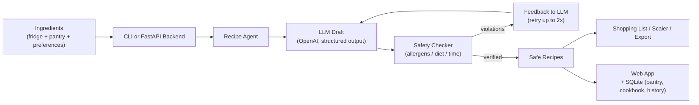

<div align="center">

# SafePlate

**Cook with what you have. Never with what you can't.**

Tell it what's in your fridge — get Indian recipes checked against your allergies and diet by a deterministic safety layer, with an AI that fixes its own mistakes before you see them.

[](https://python.org)
[](https://fastapi.tiangolo.com/)
[](https://www.langchain.com/)
[](https://openai.com)
[](https://www.sqlite.org/)


</div>

---

## Features

| Feature | Description |
|---|---|
| **Cook From Your Fridge** | Indian recipes (dal, sabzi, curry, biryani) ranked by how many of your ingredients they already use |
| **Allergen & Diet Safety** | Deterministic checks for 9 allergen groups, vegan / vegetarian / pescatarian / gluten-free / dairy-free diets and time limits — knows Indian names like *rava*, *kaju* and *curd* |
| **Self-Correcting Agent** | When a recipe breaks a rule, the AI is told exactly what's wrong and fixes it (up to 2 retries); anything still unsafe is removed |
| **Meal Planner** | 3–7 day dinner plans that rotate regions (Punjabi, South Indian, Kerala, Mumbai street food, Hyderabadi) with one merged shopping list |
| **Pantry & Cookbook** | Save staples, rate recipes, and let favourite regions shape future suggestions |
| **Web App** | Landing page with a live demo, plus an app with dashboard, recipe drawer, serving scaler, ⌘K command palette and dark mode |
| **Works Offline** | A built-in library of 14 Indian dishes runs through the same safety pipeline when no API key is set |
| **Evaluation Suite** | Held-out allergen benchmark and a fault-injection simulation — about 5× fewer unsafe recipes than trusting the AI directly |

---

## Architecture



---

## Tech Stack

- **Framework**: [FastAPI](https://fastapi.tiangolo.com/) + [Uvicorn](https://www.uvicorn.org/)
- **Frontend**: HTML5, CSS3, Vanilla JS
- **AI**: [LangChain](https://www.langchain.com/) + [OpenAI](https://openai.com) with Pydantic structured output
- **Safety Layer**: Rule-based allergen, diet and time checker
- **Storage**: SQLite (pantry, cookbook, history)
- **CLI**: [Rich](https://github.com/Textualize/rich)
- **Testing**: pytest

---

## Quick Start

### Prerequisites

- Python ≥ 3.10
- (Optional) An OpenAI API key for live AI recipes — without one, SafePlate runs in demo mode

### Installation

```bash
# Clone the repository
git clone https://github.com/MaddipatlaChetan24/SafePlate.git
cd SafePlate

# Create virtual environment
python -m venv .venv
source .venv/bin/activate   # macOS/Linux
# .venv\Scripts\activate    # Windows

# Install dependencies
pip install -r requirements.txt
```

### Configuration

Copy `.env.example` to `.env` if you want live AI recipes (entirely optional — demo mode works with none of this set):

```env
OPENAI_API_KEY=
SAFEPLATE_MODEL=gpt-4o-mini
```

### Run

```bash
# Web app
python -m safeplate serve --port 8000

# CLI
python -m safeplate suggest -i "paneer, spinach, tomatoes" --allergies nuts
```

The app opens at **http://127.0.0.1:8000/**.

---

## Project Structure

```text
SafePlate/
├── pyproject.toml               # Package metadata & CLI entry point
├── requirements.txt             # Dependencies
├── Dockerfile / render.yaml     # Deployment
├── safeplate/
│   ├── agent.py                 # Draft → verify → self-correct loop, meal planner
│   ├── safety.py                # Allergen / diet / time checker
│   ├── models.py                # Pydantic models (Recipe, Preferences, MealPlan)
│   ├── samples.py               # Offline library of 14 Indian dishes
│   ├── shopping.py              # Ingredient matching + shopping lists
│   ├── storage.py               # SQLite: pantry, cookbook, history
│   ├── export.py                # Markdown export
│   ├── server.py                # FastAPI backend
│   ├── cli.py                   # `safeplate suggest` / `plan` / `serve` ...
│   └── web/                     # Landing page + app (HTML/CSS/JS)
├── evaluation/                  # Allergen benchmark, self-correction simulation, latency
├── results/                     # Evaluation outputs (CSV + charts)
├── scripts/                     # Demo data + screenshot capture
└── tests/                       # pytest suite
```

---

## Usage

1. Run `python -m safeplate serve --port 8000` and open `http://127.0.0.1:8000/` in your browser.
2. Click **Open app**, go to **Discover** and add the ingredients in your fridge.
3. Pick your allergies, diet and time limit, then click **Generate recipes**.
4. Watch the agent trace: draft → safety check → self-correction → verified.
5. Open a recipe to scale servings, save it to your **Cookbook**, or plan the week in **Meal Planner**.

Or skip the web app and use the CLI:

```bash
python -m safeplate pantry add rice onion "toor dal"
python -m safeplate suggest --use-pantry --diet vegan --time 30 --save
python -m safeplate plan --days 5 --use-pantry --export exports/
python -m safeplate cookbook list
```

---

## Environment Variables

| Variable | Required | Description |
|---|---|---|
| `OPENAI_API_KEY` | No | Enables live AI recipes (demo mode without it) |
| `SAFEPLATE_MODEL` | No | OpenAI model to use (default: `gpt-4o-mini`) |
| `SAFEPLATE_HOME` | No | Where the SQLite database is stored (default: `~/.safeplate`) |

---

## Docker Deployment

```bash
# Build the image
docker build -t safeplate .

# Run the container
docker run -p 8000:8000 --env-file .env safeplate
```

---

## Evaluation

```bash
python -m evaluation.allergen_benchmark     # held-out allergen test cases
python -m evaluation.self_correction_sim    # unsafe recipes with vs without the loop
python -m evaluation.latency_cost           # speed + token estimates
```

---

## Tests

```bash
pytest
```

---

## License

This project is open-source and available under the MIT License.

---

<div align="center">
<sub>Built using Python, FastAPI, LangChain, OpenAI & SQLite</sub>
</div>
